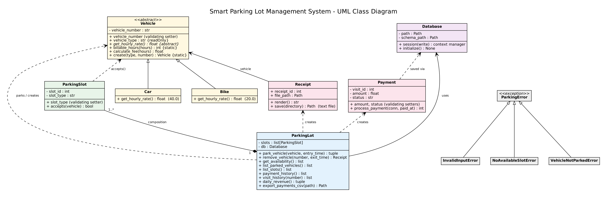
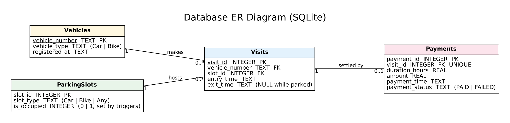

# SMART PARKING LOT MANAGEMENT SYSTEM
## Project Report

### 1. Problem Statement
Parking facilities need to know which slots are free, which vehicle occupies each slot, how long each vehicle stayed and what fee is due. Tracking this by hand leads to errors, disputes and lost records. The proposed system is a menu-driven Python application that stores vehicle, slot, visit and payment information in an SQL database and automates slot allocation, checkout, fee calculation, receipt generation and revenue reporting.

### 2. Objectives
1. Maintain vehicle entry and exit information, keeping a complete history of every visit.
2. Allocate a free slot suitable for the vehicle type.
3. Display live slot availability and the list of parked vehicles.
4. Calculate parking charges from duration and vehicle class.
5. Generate a receipt at checkout and save it as a text file.
6. Preserve records in SQLite and export payment history to CSV.
7. Report revenue per day using SQL.
8. Demonstrate Python OOP: abstraction, inheritance, overriding, polymorphism, encapsulation, composition and exception handling.

### 3. Scope
The system supports cars and bikes, separate slot types, automatic allocation, checkout, fee calculation, receipts, availability reports, slot status, payment history, visit history and a daily revenue report. It is a local single-user academic prototype. It does not include online payment, number-plate recognition or multi-user networking.

### 4. System Design
**Input:** vehicle type, registration number and menu selection.
**Processing:** validate input, find a compatible free slot, record the visit, calculate billable hours, record payment, release the slot.
**Output:** allocation confirmation, availability and slot reports, parked list, payment history, revenue report, receipt on screen and in a file, CSV export.

### 5. Classes
| Class | Responsibility |
|---|---|
| `Database` | opens transactional SQLite sessions (commit/rollback, always closes the connection); loads `schema.sql` |
| `Vehicle` (abstract) | validated plate number, billable-hour rule, `calculate_fee()`, factory `create()` |
| `Car`, `Bike` | override `get_hourly_rate()` (Rs. 40 and Rs. 20) |
| `ParkingSlot` | slot identity and type; validating setter; `accepts(vehicle)` |
| `ParkingLot` | owns the `ParkingSlot` objects; allocation, checkout, queries, reports, CSV export |
| `Payment` | validated amount/status; `process_payment()` inserts the payment inside the checkout transaction |
| `Receipt` | formats the receipt, `save()` writes it to a text file |
| `ParkingError` and subclasses | `InvalidInputError`, `NoAvailableSlotError`, `VehicleNotParkedError` |

That is 8 working classes plus the exception hierarchy.

### 6. UML Class Diagram


Also available as `diagrams/class_diagram.pdf` and `diagrams/class_diagram.svg` (Graphviz source: `class_diagram.dot`).

### 7. Database Design


| Table | Columns |
|---|---|
| `Vehicles` | `vehicle_number` PK, `vehicle_type` (Car/Bike), `registered_at` |
| `ParkingSlots` | `slot_id` PK, `slot_type` (Car/Bike/Any), `is_occupied` (0/1) |
| `Visits` | `visit_id` PK, `vehicle_number` FK, `slot_id` FK, `entry_time`, `exit_time` (NULL while parked) |
| `Payments` | `payment_id` PK, `visit_id` FK UNIQUE, `duration_hours`, `amount`, `payment_time`, `payment_status` |

**Why a `Visits` table?** In the first version the vehicle plate was the primary key of the table that also held entry and exit times, so parking the same vehicle a second time overwrote its earlier visit. A separate `Visits` table stores one row per parking session, so history is never lost and payments link to the exact visit.

**Integrity rules in the database**
- Foreign keys are on; `CHECK` constraints restrict vehicle type, slot type, occupancy flag, payment status, non-negative amounts and `exit_time >= entry_time`.
- Partial unique indexes: one open visit per vehicle and one open visit per slot (`WHERE exit_time IS NULL`).
- `Payments.visit_id` is `UNIQUE`: one payment per visit.

**Triggers**
- `trg_visit_start`: after a visit is inserted, mark its slot occupied.
- `trg_visit_end`: when `exit_time` is set, mark the slot free.

**Views**
- `v_free_slots`: slots that are currently free (used by the allocator).
- `v_daily_revenue`: revenue and payment count per day and vehicle type (`JOIN` of three tables with `GROUP BY`).

### 8. Key SQL Queries
Payment history (three-table JOIN):
```sql
SELECT p.payment_id, vi.vehicle_number, v.vehicle_type, vi.slot_id, vi.entry_time, vi.exit_time,
       p.duration_hours, p.amount, p.payment_time, p.payment_status
FROM Payments p
JOIN Visits   vi ON vi.visit_id      = p.visit_id
JOIN Vehicles v  ON v.vehicle_number = vi.vehicle_number
ORDER BY p.payment_id DESC;
```
Daily revenue (view body):
```sql
SELECT date(p.payment_time) AS day, v.vehicle_type, COUNT(*) AS payments, ROUND(SUM(p.amount), 2) AS revenue
FROM Payments p
JOIN Visits vi ON vi.visit_id = p.visit_id
JOIN Vehicles v ON v.vehicle_number = vi.vehicle_number
WHERE p.payment_status = 'PAID'
GROUP BY date(p.payment_time), v.vehicle_type;
```
Availability (aggregation):
```sql
SELECT slot_type, COUNT(*) AS total, SUM(is_occupied) AS occupied
FROM ParkingSlots GROUP BY slot_type;
```
All queries use `?` placeholders for user input, so SQL injection is not possible.

### 9. Algorithms
**Vehicle arrival**
1. Read the registration number and vehicle type.
2. Normalise and validate the number (letters/digits, 1 to 15 characters).
3. Start a write transaction. Reject if the vehicle has an open visit.
4. Read the free slots from `v_free_slots`; choose the first free slot for which `ParkingSlot.accepts(vehicle)` is true. If none, raise `NoAvailableSlotError`.
5. Insert or update the vehicle, insert a visit. The trigger marks the slot occupied.
6. Commit and display slot and entry time.

**Vehicle departure**
1. Normalise the number; find the open visit joined with the vehicle type.
2. Compute elapsed hours (never negative).
3. Billable hours = `max(1, ceil(hours))`; fee = billable hours x the vehicle's overridden hourly rate.
4. Set the visit's `exit_time` (trigger frees the slot) and insert the payment, in the same transaction.
5. Commit, then build the receipt, print it and save `receipts/receipt_<id>.txt`.

### 10. Rate Calculation
Let `h` be elapsed hours and `r` the hourly rate. Billable hours are `max(1, ceil(h))` and the fee is `billable_hours x r`. Car rate is Rs. 40 per hour; bike rate is Rs. 20 per hour. Floating-point noise is removed with `round(h, 6)` before `ceil`.

### 11. File Handling
| File | Created by | Content |
|---|---|---|
| `receipts/receipt_<id>.txt` | checkout (menu option 3) | the receipt text |
| `exports/payments.csv` | menu option 10 | full payment history, header row included |
| `parking.db` | first run | the SQLite database |

A failure to write a receipt file does not undo the (already committed) payment; the user is warned instead.

### 12. Exception Handling
- Invalid or empty registration number, duplicate active parking, invalid slot or payment values: `InvalidInputError`.
- No compatible free slot: `NoAvailableSlotError`.
- Checkout of a vehicle that is not parked: `VehicleNotParkedError`.
- Invalid menu option: corrective message, menu continues.
- SQLite, file-system, keyboard-interrupt and end-of-input errors are caught in the menu loop.
- Database sessions roll back automatically on any error, so no half-finished operations are stored.

### 13. Sample Input and Output
Screenshots of a real session are in `screenshots/`:
1. `01_parking_and_validation.png`: parking a car and bikes, duplicate and blank-input errors
2. `02_availability_and_slots.png`: availability, parked vehicles, slot map
3. `03_checkout_receipt_history.png`: checkout, receipt, unknown vehicle, payment history
4. `04_reports_export_exit.png`: revenue report, visit history, CSV export, invalid choice, exit

The complete text of that session is in `sample_run/session_transcript.txt`; the receipts and CSV it produced are in `sample_run/`.

### 14. Testing
34 automated tests in `test_parking.py` (functional cases TC01 to TC12, fee rules, encapsulation, SQL constraints, triggers, transactions, reports, file output). Latest run: **34 passed, 0 failed**. Details are in `TEST_CASES.md` and `TEST_RESULTS.txt`.

### 15. Limitations and Future Enhancements
Possible enhancements: a GUI or web interface, QR-code receipts, a real payment gateway, configurable pricing loaded from a JSON file, reservations, monthly passes and concurrent multi-user support.

### 16. Conclusion
The system shows how OOP and SQL work together to automate a practical parking workflow. It keeps a full visit history, enforces integrity inside the database, produces receipts and CSV files, reports revenue with SQL, and is covered by automated tests.
