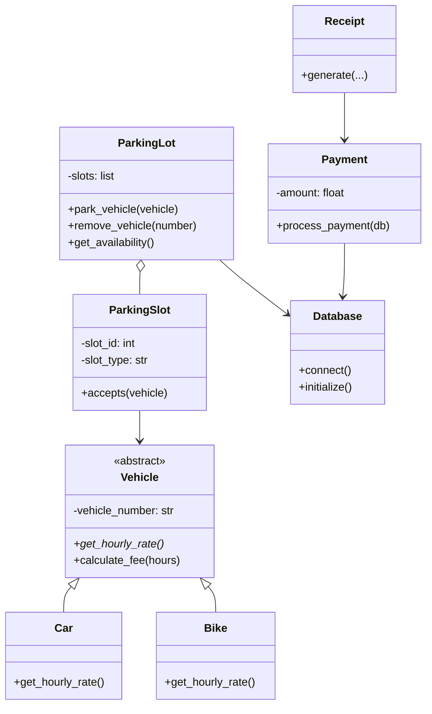

# SMART PARKING LOT MANAGEMENT SYSTEM
## Project Report

### 1. Problem Statement
Parking facilities need to know which slots are available, which vehicle occupies each slot, how long a vehicle has stayed, and what fee is due. Manual tracking can lead to errors and delays. The proposed system provides a menu-driven application that stores vehicle, slot, and payment information in an SQL database and automates allocation, checkout, fee calculation, and receipt generation.

### 2. Objectives
1. Maintain vehicle entry and exit information.
2. Allocate a free slot suitable for the vehicle type.
3. Display live slot availability and parked-vehicle lists.
4. Calculate parking charges based on duration and vehicle class.
5. Generate a receipt at checkout.
6. Preserve records using SQLite.
7. Demonstrate core Python object-oriented programming concepts.

### 3. Scope
The system supports cars and bikes, separate slot types, automatic allocation, vehicle checkout, fee calculation, receipt output, availability reports, slot status, and payment history. It is a local academic prototype and does not include online payment processing, license-plate recognition, or multi-user networking.

### 4. System Design
**Input:** vehicle type, registration number, and menu selection.  
**Processing:** validate input, find a compatible free slot, persist state, calculate billable duration, process checkout, and release the slot.  
**Output:** allocation confirmation, availability reports, parked list, payment history, and receipt.

### 5. Classes
- `Database`: SQLite connection and schema setup.
- `Vehicle` (abstract): common vehicle abstraction and fee calculation.
- `Car`: car rate implementation.
- `Bike`: bike rate implementation.
- `ParkingSlot`: slot identity, type, and compatibility logic.
- `ParkingLot`: allocation, availability, checkout, and listing operations.
- `Payment`: payment record creation.
- `Receipt`: receipt formatting.
- Custom exceptions: invalid input, unavailable slot, and vehicle not parked.

### 6. UML Class Diagram

### 7. Database Design
**Vehicles** (`vehicle_number` PK, `vehicle_type`, `entry_time`, `exit_time`, `slot_id`, `status`)  
**ParkingSlots** (`slot_id` PK, `slot_type`, `is_occupied`, `vehicle_number` unique FK)  
**Payments** (`payment_id` PK, `vehicle_number` FK, `duration_hours`, `amount`, `payment_time`, `payment_status`)

Constraints validate supported vehicle and slot types, occupancy flags, and payment status. Foreign keys are enabled.

### 8. Algorithm
**Vehicle arrival**
1. Read vehicle registration number and type.
2. Validate the number.
3. Reject if that vehicle is already parked.
4. Find the first available compatible slot.
5. Save vehicle entry and mark the slot occupied.
6. Display slot and entry timestamp.

**Vehicle departure**
1. Read registration number and find an active parking record.
2. Calculate elapsed time.
3. Round partial hours upward, with a one-hour minimum.
4. Calculate fee using the vehicle's overridden hourly rate.
5. Save payment and exit timestamp.
6. Release the slot and print the receipt.

### 9. Rate Calculation
Let `h` be elapsed hours and `r` be the vehicle's hourly rate. Billable hours are `max(1, ceil(h))`; fee is `billable_hours × r`. Car rate is Rs. 40/hour and bike rate is Rs. 20/hour.

### 10. Exception Handling
- Empty or oversized registration number: `InvalidInputError`.
- Duplicate active parking: `InvalidInputError`.
- No compatible available slot: `NoAvailableSlotError`.
- Checkout for a vehicle not parked: `VehicleNotParkedError`.
- Invalid menu option: user receives a corrective message.
- SQLite errors are caught and reported instead of terminating the menu.

### 11. Limitations and Future Enhancements
Possible enhancements include a GUI/web interface, QR-code receipts, actual payment gateway integration, configurable pricing, reservation support, monthly passes, and concurrent multi-user support.

### 12. Conclusion
The Smart Parking Lot Management System demonstrates how OOP and SQL can be combined to automate a practical parking workflow. It offers persistent records, validation, slot management, fee calculation, and receipts through a simple menu interface.
